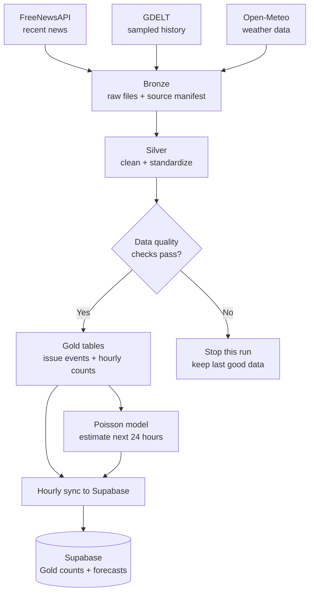
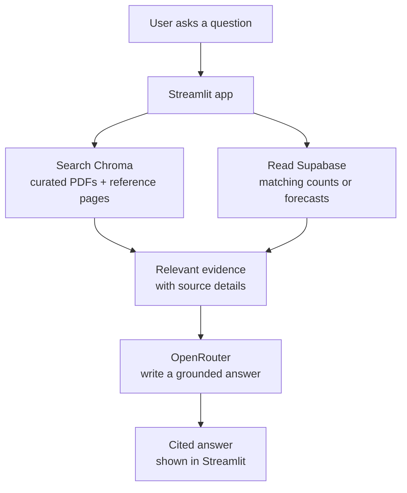

# CivicPulse

**A Pakistan-focused public-service reporting explorer.** CivicPulse organizes news reports about water, electricity, mobility, and municipal services by place and time. It adds experimental hourly report-count estimates and a chatbot that answers from selected reference documents and available project data.

> **Please read:** CivicPulse counts classified news reports. It does not verify incidents, measure service quality, or replace official alerts. Forecasts are estimates, and current evaluation shows that a simple weekly baseline performs better than the Poisson model on the recorded test set.

## What users can do

- Explore reported issues across configured Pakistan city names and four issue groups.
- See recent counts and the latest saved 24-hour forecast estimates.
- Ask questions about civic-service guidance, report patterns, or a model estimate.
- Follow citations back to the sources used in an answer.

The Streamlit app has three main areas: **Overview**, **Ask CivicPulse**, and optional **Project details**. Live Gold counts and forecasts are read from Supabase; the app does not collect or rebuild the warehouse.

## How CivicPulse works

### 1. Hourly data and forecast updates



News and sampled historical event data are preserved before they are cleaned. Quality checks protect the Gold tables; after Gold is built, the Poisson model creates experimental hourly report-count estimates. The scheduled workflow writes the counts and estimates to Supabase.

### 2. How a chatbot answer is created



Document search supplies guidance and project context. Supabase supplies matching observed counts or saved forecasts when the question calls for them. OpenRouter writes an answer from the evidence it receives; it does not calculate report totals or forecasts. The Streamlit app displays the answer and references.

### Main steps

1. **Collect:** FreeNewsAPI provides recent Pakistan news articles, GDELT provides sampled historical event records, and Open-Meteo provides weather features.
2. **Prepare:** raw responses and provenance are retained in Bronze. Silver standardizes fields, deduplicates records, and records data-quality actions.
3. **Check and summarize:** quality gates run before Gold tables are published. Gold contains issue events, hourly report counts, freshness information, and model features.
4. **Estimate:** Poisson regression uses Gold counts, location, issue group, time, and available weather to estimate future report counts. Results include Poisson intervals.
5. **Retrieve and answer:** RAG searches selected documents; the app adds relevant Supabase evidence. OpenRouter turns that evidence into a concise answer with references.

## Data and reference sources

### Analytics inputs

- **FreeNewsAPI:** recent news articles tagged for Pakistan. The collector uses a four-hour overlap by default; article URLs are deduplicated during processing.
- **GDELT 2.0:** historical event records sampled from four 15-minute exports per day by default. This is a sample, not a complete archive.
- **Open-Meteo:** historical weather features and forecast weather used by the model. Weather is a model input, not evidence that a civic incident occurred.

### RAG references

The document index includes the local NDMA and Pakistan Citizen Portal PDFs, CivicPulse model/data documentation, and a small set of selected public pages from PMD, KW&SC, and K-Electric. The website fetcher checks site access rules and does not crawl linked pages. The index is curated reference material, not a live web search.

Source-use notes: FreeNewsAPI article text remains publisher-owned; link to original publishers. Cite the GDELT Project when using its data. Open-Meteo data requires CC BY 4.0 attribution. Raw source records and provenance are kept in the local Bronze files and `data/manifest.csv`.

## Model and evaluation

The model estimates **classified news-report counts**, not confirmed incidents or emergency risk. CivicPulse uses a Poisson regression with city, issue group, calendar, and available weather features. Its 95% Poisson intervals are uncertainty estimates; calibrated coverage has not been established.

The frozen chronological evaluation has 996,824 city/issue/hour grid rows but only 28 actual reports. The weekly seasonal baseline scored a full-grid MAE of `0.0000551752`; Poisson scored `0.0000690631`. The baseline performed better, and most test rows were zero. CivicPulse does not claim that Poisson improves forecast accuracy. Sparse data and noisy location labels also limit city-level comparisons.

The target is sparse, the baseline performed better, and prediction intervals have not been shown to be calibrated. Use results for exploratory monitoring and evaluation, not operational decisions or public safety alerts.

## Set up locally (Windows PowerShell)

Install Python 3.10 or newer, Git, and VS Code. From the repository folder:

```powershell
python -m venv .venv
.\.venv\Scripts\python.exe -m pip install --upgrade pip
.\.venv\Scripts\python.exe -m pip install -e ".[dev,app,rag]"
```

The first RAG index build may download the multilingual embedding model. Network access is needed for source collection and that initial model download.

Create a private local environment file for OpenRouter and other optional settings:

```powershell
Copy-Item .env.example .env
```

Add your `OPENROUTER_API_KEY` to `.env` to enable generated answers. Do not commit `.env` or any real key. The Streamlit app also accepts secrets in `.streamlit/secrets.toml`.

## Run the project

### Build and inspect the data

```powershell
.\.venv\Scripts\python.exe -m civicpulse data
.\.venv\Scripts\python.exe -m civicpulse stats
```

`data` ensures the historical GDELT sample is present, fetches current source data, and rebuilds Bronze, Silver, and Gold. The first backfill can take a while. `stats` prints warehouse counts, quality summaries, and freshness.

Other useful commands:

```powershell
.\.venv\Scripts\python.exe -m civicpulse build           # rebuild from files already fetched
.\.venv\Scripts\python.exe -m civicpulse evaluate-model  # run the locked historical evaluation
.\.venv\Scripts\python.exe -m civicpulse forecast-model  # fit on current Gold and save 24-hour estimates
```

### Build and query RAG

```powershell
.\.venv\Scripts\python.exe -m civicpulse rag-index
.\.venv\Scripts\python.exe -m civicpulse rag-retrieve --question "How can a resident report a water supply problem?"
.\.venv\Scripts\python.exe -m civicpulse rag-answer --question "How can a resident report a water supply problem?"
```

`rag-retrieve` returns evidence without generating an answer. `rag-answer` sends the question and retrieved evidence to OpenRouter. Rebuild the index after changing its PDFs or reference documents. Gold rows and forecasts are read as structured evidence; they are not embedded into the document index.

### Start the web app

Set these values in `.streamlit/secrets.toml` for local use, or in Streamlit Community Cloud **App settings → Secrets** after deployment:

```toml
SUPABASE_URL = "https://your-project-ref.supabase.co"
SUPABASE_PUBLISHABLE_KEY = "your-read-only-publishable-key"
OPENROUTER_API_KEY = "your-openrouter-key"
OPENROUTER_MODEL = "openai/gpt-4o-mini"
OPENROUTER_BASE_URL = "https://openrouter.ai/api/v1"
```

Enable Row Level Security and read policies for the app’s required tables. Never put the Supabase Secret/service key in Streamlit secrets or browser-facing code.

```powershell
.\.venv\Scripts\python.exe -m streamlit run app.py
```

### Run automated checks

```powershell
.\.venv\Scripts\python.exe -m pytest -q
```

The test suite uses fixtures and mocks for external services; the GitHub workflow runs it before the hourly data job.

## Hourly workflow and deployment

`.github/workflows/hourly-data.yml` runs at minute 17 of each UTC hour (when GitHub starts the scheduled job). It runs tests, restores cached warehouse state, collects/builds data, evaluates the locked model, creates the next 24-hour Poisson forecasts, and upserts Gold and forecast rows into Supabase. The watchdog workflow checks for missed or failed hourly runs and can dispatch recovery. GitHub schedules are best-effort, not a real-time guarantee; the Actions cache is also best-effort storage.

Required GitHub Actions repository secrets for the writer:

- `SUPABASE_URL`
- `SUPABASE_SECRET_KEY` — server-side write credential; never use in the Streamlit app

The Streamlit app is deployed separately from the repository with `app.py` as its entry point. It reads Supabase using the Publishable key and RLS. Supabase is the persistent store for the app’s Gold counts and forecasts; GitHub Actions does the hourly writing. Configure the Chroma index and OpenRouter key as deployment assets/secrets as described above.

See [SETUP.md](SETUP.md) for additional local setup and scheduling instructions.

## Repository map

```text
app.py                          Streamlit overview, project details, and cited chat
src/civicpulse/ingest/          FreeNewsAPI, GDELT, and Open-Meteo collection
src/civicpulse/warehouse/       Bronze, Silver, and Gold transformations
src/civicpulse/quality/          Data-quality checks and action logging
src/civicpulse/modeling/         Poisson forecasting and baseline evaluation
src/civicpulse/rag/              Document parsing, Chroma indexing, retrieval, answers
scripts/sync_gold_to_supabase.py Hourly Gold and forecast upserts
tests/                           Automated unit/integration tests with fixtures
app_data/chroma/                 Packaged RAG index used by the deployed app
```

## Main limits to keep in mind

- News coverage reflects available sources and media attention, not every service issue.
- GDELT history is sampled; source classifications and location labels can be noisy.
- Coverage varies by city, issue, and time. Missing rows do not mean zero real-world incidents.
- Poisson is experimental and did not beat the weekly baseline in the recorded evaluation.
- RAG answers depend on the selected documents and the freshness of indexed references; check linked sources for current official guidance.
